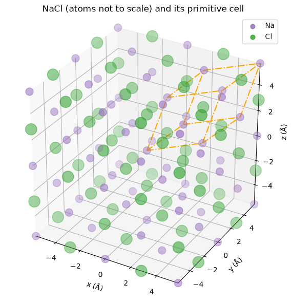
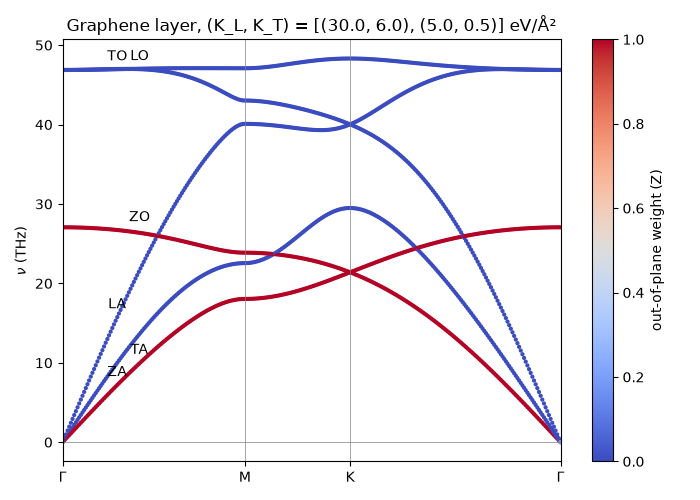
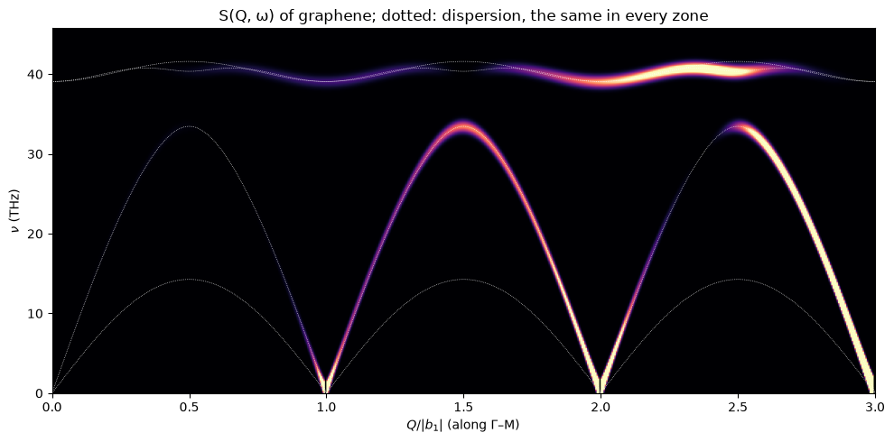
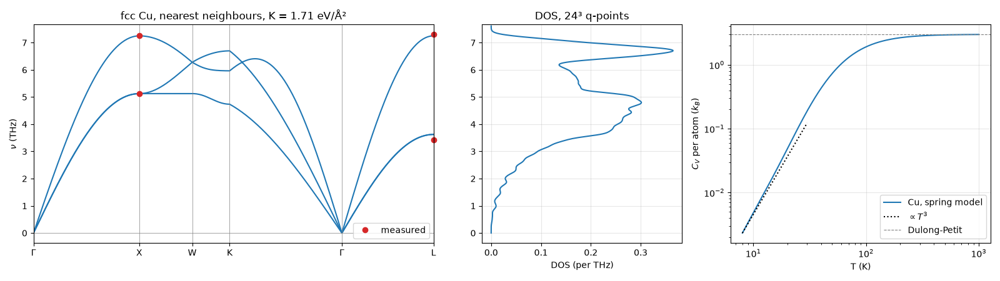

# latticephys

latticephys computes and visualizes the vibrations of lattices (phonons) — molecules, chains, ribbons, layers and 3D crystals — with spring models checked against analytic results and experiment. The aim is a general library for the physics of lattices: phonons first, with more models, quasi-particles and dynamics to follow (see [`TODO.md`](TODO.md)).

<p align="center">
  
  
  
  
</p>

## Install

Python ≥ 3.12:

```sh
pip install "latticephys @ git+https://github.com/CubelaPetar/latticephys"
```

## Quickstart

Phonon bands of graphene with springs to the first and second neighbours:

```python
import matplotlib.pyplot as plt

from latticephys.lattice.bonds import neighbour_bonds
from latticephys.lattice.plot import plot_bands
from latticephys.lattice.reciprocal import k_path, special_points
from latticephys.lattice.structures import honeycomb
from latticephys.phonons.dispersion import dispersion
from latticephys.units import OMEGA_TO_THZ

graphene = honeycomb(2.46, [12.011] * 2, ["C"] * 2)        # lattice constant (Å), masses (amu), names
bonds = neighbour_bonds(graphene, [25.0, 5.0])             # spring constant (eV/Ų) per neighbour shell
points = special_points("hexagonal", graphene.vectors)
qs, distance, corners = k_path([points[p] for p in "ΓMKΓ"])
plot_bands(distance, dispersion(graphene, bonds, qs) * OMEGA_TO_THZ, corners, list("ΓMKΓ"))
plt.show()
```

## What you can compute

| | Functions |
|---|---|
| Structures: 5 + 14 Bravais lattices, honeycomb, kagome, Lieb, rocksalt, diamond, hcp, bilayers, layers in 3D | `Crystal`, `bravais2d/3d.primitive_vectors`, `lattice.structures`, `embed`, `plot_crystal` |
| Bonds to neighbour shells, central or (K_L, K_T) springs; supercells; Φ and Φ(q) | `neighbour_bonds`, `periodic_supercell`, `force_constants` |
| Brillouin zone, special points, paths, grids | `special_points`, `k_path`, `q_grid`, `plot_brillouin_zone` |
| Band structures, polarizations, mode character, group and sound velocities | `dispersion`, `phonon_modes`, `atom_weights`, `group_velocities`, `sound_velocities`, `plot_bands` (lines or coloured by weight) |
| Density of states, heat capacity, ⟨u²⟩ | `density_of_states`, `heat_capacity`, `mean_square_displacement` |
| Neutron/X-ray scattering intensity S(Q, ω) | `structure_factor`, `intensity_map` |
| Normal modes of molecules and finite systems, Bloch modes and their exact motion, time evolution, animation | `phonon_modes` at q = 0, `normal_modes`, `bloch_mode`, `mode_motion`, `mode_start`, `simulate`, `animate` |
| JSON export, e.g. for web pages | `save_json` |

Inputs are in Å, amu and eV; `latticephys.units` converts frequencies to THz, meV or cm⁻¹. More in the guide: [concepts](docs/guide/concepts.md), [models](docs/guide/models.md), [units](docs/guide/units.md), and the terms in [`GLOSSARY.md`](GLOSSARY.md).

## Limits

Harmonic springs only: no bending forces (the graphene ZA branch is linear, not ∝ q²), no long-range Coulomb forces (no LO–TO splitting in ionic crystals), no anharmonic effects. See [models](docs/guide/models.md).

## Examples

30 runnable scripts, each explaining its physics in the docstring; the list is in [`examples/README.md`](examples/README.md).

| Folder | Content |
|---|---|
| `molecules/` | CO₂ normal modes and animation |
| `chains/` | dispersion, wave packets, impurity modes, heat capacity, S(Q, ω) |
| `lattices_2d/` | 2D structures, Brillouin zones, bands, waves, DOS, nanoribbon edge modes, Mermin–Wagner |
| `layers/` | graphene layer and AB bilayer with out-of-plane modes |
| `crystals_3d/` | NaCl, Si, Cu, Fe and Mg; Si and Cu against neutron data |
| `export/` | JSON for web pages |

## Development

```sh
python3 -m venv .venv
.venv/bin/pip install -r requirements.txt
.venv/bin/pytest && .venv/bin/ruff check
```

Every physical result is checked in a test against an analytic formula, an experimental value or an independent calculation; `tests/test_examples.py` runs every example headless. `docs/images/make_images.py` regenerates the images above. Animations use `pygame-ce`, a drop-in fork of pygame (`import pygame`).

## License

MIT, see [`LICENSE`](LICENSE).
